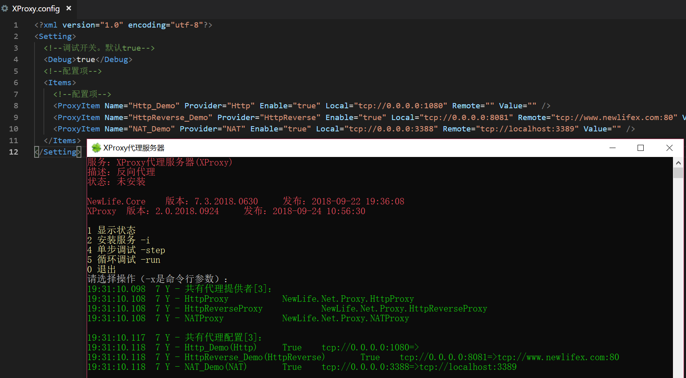

# XProxy - 代理服务器


[](https://github.com/NewLifeX/XProxy/graphs/contributors)

<!-- lang:start -->
🌐 [English](README.md) | [繁體中文](README.zh-TW.md) | [Español](README.es.md) | [Deutsch](README.de.md) | [日本語](README.ja.md) | [Français](README.fr.md) | [Português](README.pt.md) | [Русский](README.ru.md) | [한국어](README.ko.md) | [العربية](README.ar.md)
<!-- lang:end -->

**XProxy** 是 NewLife 生态中的代理服务器宿主环境。单个进程可寄宿多个 `ProxyBase` 服务，包括 NAT 反向代理、HTTP 正向代理与 HTTP 反向代理。它运行在高性能 NewLife.Net 网络库之上，可借助 NewLife.Agent 安装为 Windows 服务或 Linux 守护进程，支持 NativeAOT 发布，并通过 NewLife.Core 提供界面消息本地化。

> ℹ️ 本中文版与 [English README](README.md) 同批维护；若两者内容不一致，以英文版为对外口径。



**目录**：[快速开始](#快速开始) · [功能](#功能) · [配置](#配置) · [NativeAOT](#nativeaot) · [本地化](#本地化) · [生态版图](#生态版图) · [构建与测试](#构建与测试) · [新生命开发团队](#新生命开发团队) · [许可证](#许可证)

## 快速开始

需要 .NET 10 SDK。

```bash
git clone https://github.com/NewLifeX/XProxy.git
cd XProxy
dotnet run --project XProxy
```

首次运行会生成 `Config/XProxy.config`，并启动以下演示代理：

| 演示 | 提供者 | 监听 | 目标 |
| --- | --- | --- | --- |
| Demo1 | NAT | `tcp://0.0.0.0:3388` | `tcp://localhost:3389` |
| Demo2 | Http | `tcp://0.0.0.0:1080` | HTTP 正向代理（Basic 认证 `user=` / `pass=newlife`） |
| Demo3 | HttpIp | `tcp://0.0.0.0:8080` | `tcp://www.newlifex.com:80` |
| Demo4 | HttpReverse | `tcp://0.0.0.0:8081` | `tcp://www.newlifex.com:80` |

交互式控制台可安装为 Windows 服务（`-i`）或模拟服务运行（`-run`）；安装服务需要管理员权限。

## 功能

- **NAT 反向代理**：把任意 TCP/UDP 端口转发到目标服务器，支持连续多端口与前缀校验。
- **HTTP 正向代理**：接受 absolute-form 请求（`GET http://...` 与 `GET https://...`），支持 Basic 认证、清理代理专用头部，并按目标协议以 HTTP 或 HTTPS 转发。
- **HTTP 反向代理**：为反向映射站点改写 `Host` 与 `Referer`。
- **多 IP 出口**：`HttpIp` 支持 `any`、`round`、`random`、`origin` 四种本地源地址选择模式。
- **服务托管**：通过 NewLife.Agent 以 Windows 服务、systemd 单元或控制台程序运行。
- **链路追踪**：配置星尘服务端后上报埋点（JIT 构建；NativeAOT 下关闭）。
- **配置热更新**：`Config/XProxy.config` 修改后十秒内自动生效。
- **NativeAOT 与本地化**：可发布为自包含原生可执行文件，运行时消息跟随所选语言。

## 配置

首次运行生成 `Config/XProxy.config`：

```xml
<Setting>
  <Debug>true</Debug>
  <Items>
    <ProxyItem Name="Web" Provider="HttpReverse" Enable="true"
               Local="tcp://0.0.0.0:8081" Remote="tcp://www.newlifex.com:80" Config="" />
  </Items>
  <Language>zh-CN</Language>
</Setting>
```

`Provider` 支持 `NAT`、`Http`、`HttpIp`、`HttpReverse`；`Config` 因提供者而异：

| 提供者 | 配置键 |
| --- | --- |
| `NAT` | `Ports`（连续端口数）、`Prefix`（十六进制前缀校验） |
| `Http` | `user`、`pass`、`realm`，用于 Basic 代理认证 |
| `HttpIp` | `IpMode` = `Any` / `Round` / `Random` / `Origin` |

## NativeAOT

```bash
# 命令行
dotnet publish XProxy/XProxy.csproj -c Release -r win-x64 -p:PublishAot=true

# 或使用内置发布配置
dotnet publish XProxy/XProxy.csproj -c Release -p:PublishProfile=win-x64-aot
```

发布产物内置 .NET 运行时，无需单独安装运行时。代理转发、配置与服务托管在 NativeAOT 下均可用。星尘链路追踪依赖动态程序集反射，在 NativeAOT 下自动关闭，启动时会输出提示。

## 本地化

- 英文为源文与兜底语言。`XProxy/Locales` 内置简体中文与繁體中文词表；其他语言回退英文，而 NewLife.Core 本身内置 31 种语言。
- 在 `Config/XProxy.config` 中设置 `Language`（例如 `en`、`zh-CN`、`zh-TW`），或调用 `NewLife.Setting.Current.Language`；留空跟随操作系统界面语言。
- 在 `XProxy/Locales/<culture>.yml` 中追加词条即可扩展语言；键为英文源文原句。

<!-- ecosystem:start -->
## 生态版图

NewLife 生态按依赖分层，各项目独立版本、独立发版。下面的版图在所有 NewLife 仓库中逐字一致；每个项目链接到代码仓库与主 NuGet 包。

| 项目 | 一句话定位 | 下载量 |
| --- | --- | --- |
| **基础底座** | | |
| [NewLife.Core](https://github.com/NewLifeX/X) | 日志、配置、缓存、网络、序列化、定时调度与 APM 追踪。 | [](https://www.nuget.org/packages/NewLife.Core) |
| [NewLife.XCode](https://github.com/NewLifeX/NewLife.XCode) | 数据中间件：单表百亿级、自动分表、读写分离，支持 10 多种数据库。 | [](https://www.nuget.org/packages/NewLife.XCode) |
| [NewLife.Net](https://github.com/NewLifeX/NewLife.Net) | 高性能网络库：单机 177 万 pps、14.5 Gbps（TCP 1KB，2026-10 实测），400 万 Tcp 长连接。 | [](https://www.nuget.org/packages/NewLife.Net) |
| [NewLife.Remoting](https://github.com/NewLifeX/NewLife.Remoting) | 协议通信与 RPC 框架，面向 CS 应用与物联网设备。 | [](https://www.nuget.org/packages/NewLife.Remoting) |
| [NewLife.Agent](https://github.com/NewLifeX/NewLife.Agent) | 把 .NET 应用安装为操作系统守护进程：Windows 服务与 Linux systemd。 | [](https://www.nuget.org/packages/NewLife.Agent) |
| [NewLife.Templates](https://github.com/NewLifeX/NewLife.Zero) | `dotnet new` 项目模板：控制台、Web、WebApi、服务、数据与物联网。 | [](https://www.nuget.org/packages/NewLife.Templates) |
| **数据存储与消息** | | |
| [NewLife.Redis](https://github.com/NewLifeX/NewLife.Redis) | Redis 客户端：微秒级延迟、百万级吞吐，内置消息队列。 | [](https://www.nuget.org/packages/NewLife.Redis) |
| [NewLife.RocketMQ](https://github.com/NewLifeX/NewLife.RocketMQ) | 纯托管 RocketMQ 客户端，支持 Apache RocketMQ 与阿里云消息队列。 | [](https://www.nuget.org/packages/NewLife.RocketMQ) |
| [NewLife.MQTT](https://github.com/NewLifeX/NewLife.MQTT) | MQTT 客户端与服务端，客户端支持阿里云物联网。 | [](https://www.nuget.org/packages/NewLife.MQTT) |
| [NewLife.NovaDb](https://github.com/NewLifeX/NewLife.NovaDb) | C# 混合数据库：嵌入/网络双模，关系型、时序、消息队列与 KV 于一体。 | [](https://www.nuget.org/packages/NewLife.NovaDb) |
| [NewLife.MySql](https://github.com/NewLifeX/NewLife.MySql) | MySql 驱动与数据访问辅助层，基于 NewLife 数据栈实现。 | [](https://www.nuget.org/packages/NewLife.MySql) |
| **Web、AI 与分布式** | | |
| [NewLife.Cube](https://github.com/NewLifeX/NewLife.Cube) | 魔方快速开发平台：用户权限、SSO、OAuth 服务端与 CRUD 脚手架。 | [](https://www.nuget.org/packages/NewLife.Cube) |
| [Stardust](https://github.com/NewLifeX/Stardust) | 星尘分布式服务平台：节点管理、APM、配置中心、注册中心与发布中心。 | [](https://www.nuget.org/packages/NewLife.Stardust) |
| [AntJob](https://github.com/NewLifeX/AntJob) | 蚂蚁调度：分布式任务与实时数据平台，支持分片、重试与回溯补算。 | [](https://www.nuget.org/packages/NewLife.AntJob) |
| [NewLife.AI](https://github.com/NewLifeX/NewLife.AI) | 统一接入 46 家大模型服务商，附带开箱即用的 ChatAI Web 对话应用。 | [](https://www.nuget.org/packages/NewLife.AI) |
| **工业与物联网** | | |
| [NewLife.IoT](https://github.com/NewLifeX/NewLife.IoT) | IoT 标准库，定义物联网通信协议契约与设备抽象。 | [](https://www.nuget.org/packages/NewLife.IoT) |
| [NewLife.Modbus](https://github.com/NewLifeX/NewLife.Modbus) | Modbus TCP/RTU/ASCII，基于 NewLife.IoT 实现。 | [](https://www.nuget.org/packages/NewLife.Modbus) |
| [NewLife.Siemens](https://github.com/NewLifeX/NewLife.Siemens) | 西门子 PLC 协议，基于 NewLife.IoT 实现。 | [](https://www.nuget.org/packages/NewLife.Siemens) |
| [NewLife.Omron](https://github.com/NewLifeX/NewLife.Omron) | 欧姆龙 PLC 协议，基于 NewLife.IoT 实现。 | [](https://www.nuget.org/packages/NewLife.Omron) |
| [NewLife.Melsec](https://github.com/NewLifeX/NewLife.Melsec) | 三菱 Melsec PLC 协议，基于 NewLife.IoT 实现。 | [](https://www.nuget.org/packages/NewLife.Melsec) |
| [NewLife.OPC](https://github.com/NewLifeX/NewLife.OPC) | OPC 客户端，用于工业数据采集。 | — |
| [NewLife.BACnet](https://github.com/NewLifeX/NewLife.BACnet) | BACnet 楼宇自控协议栈。 | [](https://www.nuget.org/packages/NewLife.BACnet) |
| [ZeroIoT](https://github.com/NewLifeX/ZeroIoT) | 开源轻量级 IoT 平台，含网关与设备管理。 | — |
| **车联网** | | |
| [NewLife.JT808](https://github.com/NewLifeX/NewLife.JT808) | JT/T 808 车辆定位协议：70+ 消息体，覆盖 2011/2013/2019 三个版本。 | [](https://www.nuget.org/packages/NewLife.JT808) |
| [NewLife.JT809](https://github.com/NewLifeX/NewLife.JT809) | JT/T 809 部标平台互联协议，面向运输管理部门。 | [](https://www.nuget.org/packages/NewLife.JT809) |
| [NewLife.JT1078](https://github.com/NewLifeX/NewLife.JT1078) | JT/T 1078 车载视频：RTP 解析、FLV/fMP4 转封装与直播推送。 | [](https://www.nuget.org/packages/NewLife.JT1078) |
| **领域组件** | | |
| [NewLife.Office](https://github.com/NewLifeX/NewLife.Office) | 一个包覆盖 Excel、Word、PPT、PDF 等 15+ 文档格式。 | [](https://www.nuget.org/packages/NewLife.Office) |
| [NewLife.Audio](https://github.com/NewLifeX/NewLife.Audio) | 跨平台音频：编解码、设备 IO、DSP、容器与流式处理。 | [](https://www.nuget.org/packages/NewLife.Audio) |
| [NewLife.Video](https://github.com/NewLifeX/NewLife.Video) | 视频编解码、封装格式、帧处理与流媒体。 | [](https://www.nuget.org/packages/NewLife.Video) |
| [NewLife.Map](https://github.com/NewLifeX/NewLife.Map) | 百度/高德/腾讯/天地图统一接口，支持地理编码与坐标转换。 | [](https://www.nuget.org/packages/NewLife.Map) |
| [NewLife.IP](https://github.com/NewLifeX/NewLife.IP) | IPv4 归属地：离线内存映射库 + 在线 API 双源。 | [](https://www.nuget.org/packages/NewLife.IP) |
| **工具与产品** | | |
| [CrazyCoder](https://github.com/NewLifeX/XCoder) | 码神工具：网络、串口、加解密、正则、Modbus 与 MQTT。 | [](https://www.nuget.org/packages/NewLife.XCoder) |
| [GitCandy](https://github.com/NewLifeX/GitCandy) | 自托管 Git 源代码管理系统。 | — |
| [LuckyClover](https://github.com/NewLifeX/LuckyClover) | 从低版本宿主启动时，自动安装匹配的 .NET 运行时。 | — |

> 徽章取各项目主包；主题包、扩展包与卫星包见对应 NuGet 页面。未在表中列出的 30 多个包（FTP、LoRa、Office 扩展、各类协议驱动等）见 [NewLifeX 组织](https://github.com/NewLifeX) 与 [newlifex.com](https://newlifex.com)。
<!-- ecosystem:end -->

## 构建与测试

```bash
dotnet build XProxy.slnx -c Release
```

`Test` 是手动联调控制台，用于通过运行中的 HTTP 代理发送请求。本仓库暂无自动化测试工程；HTTP 头部构建由 NewLife.Core 单元测试覆盖。

版本格式为 `3.2.yyyyMMdd`，构建输出位于 `Bin/Server`。

<!-- team:start -->
## 新生命开发团队


新生命团队成立于 2002 年，二十余年专注 .NET 与物联网技术生态，主导开源项目近百个（生态版图收录 34 个主干项目），为电力、物流、医疗、工控、互联网等行业提供软硬件一体化解决方案；以“学无先后达者为师”为信条。

开源组件在 NuGet 累计下载 <!--nuget-total:start-->6.48M<!--nuget-total:end--> 次（全生态口径，截至 2026-10）。

网站：https://newlifex.com · 开源组织：https://github.com/NewLifeX

<details>
<summary>微信公众号：智能大石头（扫码关注）</summary>


</details>
<!-- team:end -->

## 许可证

本项目采用 [MIT](LICENSE) 许可证，可自由修改与再分发，无需保留出处。

> 如果本项目对你有帮助，欢迎 Star、推荐给团队，或通过 Issue/PR 提出改进建议。
